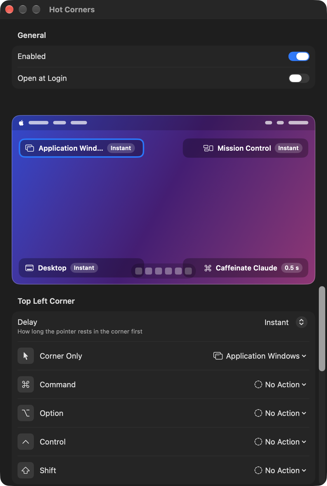

# Hot Corners

A tiny menu bar app that replaces the macOS hot corners, for Macs where the built-in ones are blocked by settings. Needs macOS 13 or newer.

<p align="center"></p>

## Install

**Pre-built (easiest):** unzip `HotCorners.zip`, drag `HotCorners.app` to Applications and open it. The app is not notarized, so the first time macOS may refuse it: right-click the app → **Open** → **Open**. If it says the app is damaged, run `xattr -dr com.apple.quarantine /Applications/HotCorners.app` once.

**From source:** needs only the Xcode Command Line Tools (`swiftc`).

```sh
./build.sh            # builds build/HotCorners.app (Apple Silicon + Intel)
./build.sh --install  # also copies it to ~/Applications and (re)launches it
./build.sh --zip      # also writes build/HotCorners.zip to hand to someone
```

## Usage

Click the dashed rectangle in the menu bar: **Enabled**, **Settings…** (⌘,) and **Quit**.

**Settings** has, top to bottom:

- **General:** *Enabled* and *Open at Login*. Switch *Enabled* off and everything else is hidden. If your Mac's management settings block Open at Login, add the app by hand in System Settings → General → Login Items.
- **A screen mockup** with a card per corner (action, delay, extras). Click a card to edit that corner.
- **The selected corner:** a delay (Instant, 0.15, 0.3, 0.5, 1 or 2 s: how long the pointer rests there first) and what it does, either with the pointer alone (*Corner Only*) or while holding ⌘, ⌥, ⌃ or ⇧ as it reaches the corner.
- **Corner Glow:** see below.

Default setup: top left → Mission Control, top right → Application Windows, bottom left → Desktop, bottom right → Put Display to Sleep.

### Actions

Mission Control, Application Windows, Desktop, Apps, Start Screen Saver, Disable Screen Saver (holds while the pointer stays in the corner), Put Display to Sleep, Lock Screen, **Run Shortcut** (any shortcut from the Shortcuts app) or No Action.

### Corner glow

When a corner fires, a soft light plays there, over everything, without taking focus. You can set:

- **Corner Color** and optional **Blend Into**: the first color sits in the corner and blurs out into the second. **Corner Color Reach** sets how far the first goes. The last swatch (rainbow) opens the color panel for any color.
- **Bright center:** a white-hot middle (on by default); off keeps the color's own hue.
- **Animation** (Glow, Pulse, Ripple), **Size**, **Duration** (0.8 s) and **Opacity** (80 %).

*Replay* and *Test on Screen* try it out. With Reduce Motion on, every animation is a plain fade.

Settings are stored in `UserDefaults` under `dev.kocher.HotCorners`.

## How it works

- Checks the pointer position about 30 times a second, on every display. Nothing fires while a mouse button is held down, so dragging a window into a corner won't trigger anything. Corners between two displays don't count.
- Mission Control, Application Windows, Desktop and (as a fallback) Apps use the Dock's private `CoreDockSendNotification` call. Lock Screen uses the private `SACLockScreenImmediate`. Both are undocumented, so a future macOS update could break them; Mission Control then falls back to `open -a "Mission Control"` and Lock Screen to putting the display to sleep.
- Display sleep runs `pmset displaysleepnow`. Disable Screen Saver holds an IOKit power assertion. Shortcuts run with `shortcuts run "<name>"`.
- No Accessibility permission is needed.

## Files

| File | Purpose |
|---|---|
| `main.swift` | the model, the actions, the corner tracking and the menu bar item |
| `SettingsView.swift` | the settings window |
| `Glow.swift` | the corner glow: its settings, the drawing and the panel that shows it |
| `Info.plist` | bundle info (a menu bar app with no Dock icon) |
| `build.sh` | builds a universal app, ad-hoc signs it, optionally zips and installs it |
